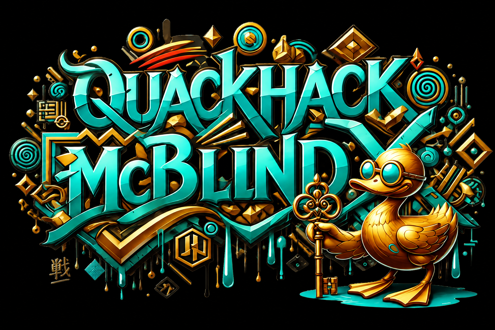

# **🦆 QuackHack-McBlindy 🧑‍🦯**

[QuackHack-McBLindy.com](https://quackhack-mcblindy.com/)

## **Ecosystem**

- **❄️** [tinyFlake](https://github.com/QuackHack-McBlindy/tinyFlake) **- my projects start with a tinyFlake.**   
- **🛠️** [dotfiles](https://github.com/QuackHack-McBlindy/dotfiles) **- all**+**servers**+**phone**+**scripts**+**lights**+**TVs**+**bed**+**automations**+**everything else.**  
- **🗣️** [yo](https://github.com/QuackHack-McBlindy/yo) **- fast, flake-native deterministic natural-language command engine with an offline voice interface.**   
- **🦆** [zigduck](https://github.com/QuackHack-McBlindy/zigduck) **-  reproducible and deployable smart home automation system as a flake.**  
**Embedded / Hardware** 
- **⌚️** [ESP32-S3-WATCH-rs](https://github.com/QuackHack-McBlindy/ESP32-S3-WATCH-rs) **- Voice-driven bare metal wearable operating system on your wrist.**  
- **📭** [ESP32-S3-BOX-3-rs](https://github.com/QuackHack-McBlindy/ESP32-S3-BOX-3-rs) **-** *(mostly)* **docked voice assistant.**  
**Libraries** 
- **🗣️** [yo-esp](https://github.com/QuackHack-McBlindy/yo-esp) **- rust no std audio library for ESP32 microcontrollers.**   
- **📦** [crates.io](https://crates.io/users/QuackHack-McBlindy) **- QuackHack-McBlindy @ crates.io**  

## **Misc**  

- **🤯** [prototype](https://github.com/QuackHack-McBlindy/dotfiles/blob/main/bin/disabled/voice/do-bash.nix) **- code as art.**  
- **🔍** [magnixify](https://github.com/QuackHack-McBlindy/magnixify-gnome-shell-extension) **- improved desktop magnifier.**  
- **🔴** [PokéNix](https://github.com/QuackHack-McBlindy/pokenix) **- pokémon collection website builder.**  
- **💼** [portfolio](https://quackhack-mcblindy.com/) **- QuackHack-McBLindy.com**  

## **☕**  

> 🦯🦆 says ▶ Hi! I'm QuackHack-McBlindy!  
> Like my work?  
> Buy me a coffee, or become a sponsor.  
> Thanks for supporting open source/hungry developers ♥️🦆!   

♥️₿ *Wallet:* `pungkula.x`  
[ "")](https://github.com/sponsors/QuackHack-McBlindy) 
